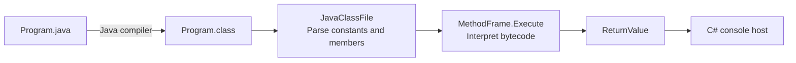

# CoffeeMakerVM

[](#project-status)
[](CoffeeMakerVM/CoffeeMakerVM)
[](CoffeeMakerVM/CoffeeMakerVM/CoffeeMakerVM.csproj)
[](JavaByteCode/gradle/wrapper/gradle-wrapper.properties)
[](LICENSE)

> From Java class files to a C# execution loop.

CoffeeMakerVM is an experimental Java Virtual Machine written in C#. It reads compiled Java `.class` files, parses their constant pools and members, and interprets a subset of JVM bytecode using its own operand stacks, local variables, and method frames.

The repository pairs the C# interpreter with a small Java project and focused unit tests. Its bundled demo uses recursive Fibonacci and factorial methods to exercise arithmetic, conditional branches, method calls, and return values.

## Why CoffeeMakerVM?

A short Java method passes through several layers before it produces a result. CoffeeMakerVM makes those layers available to inspect: the binary class-file format, symbolic references, bytecode instructions, and the stack operations behind each call.

The implementation provides a compact place to explore:

- Reading big-endian values and validating the `CAFEBABE` class-file signature.
- Resolving constant-pool entries into class, field, and method information.
- Tracking an instruction pointer, operand stack, and local variables.
- Executing recursive static methods with separate frames.
- Experimenting with static fields, object references, and a simple heap.
- Checking low-level helpers with small, byte-oriented tests.

## How it works



### Class-file loading

`JavaClassFile` reads the class header, constant pool, interfaces, fields, methods, and attributes. It separates static and instance members and executes a class initializer when a `<clinit>` method is present.

The parser has readers for UTF-8, integer, float, long, double, string, class, name-and-type, and field or method reference constants. Method `Code` attributes become executable `MethodFrame` values.

### Stack-based interpretation

`MethodFrame.Execute` allocates local-variable and operand-stack spans from the method's declared limits, copies supplied parameters into the locals, and dispatches instructions through an opcode switch.

The current interpreter includes handlers in these areas:

| Area | Examples in the implementation |
| --- | --- |
| Stack operations | `nop`, `pop`, `dup`, `bipush`, `sipush`, `ldc` |
| Integer values | Small integer constants and local loads/stores for slots 0–3 |
| Integer arithmetic | Addition, subtraction, multiplication, division, remainder, and increment |
| Branching | Selected zero checks and integer comparisons |
| Static methods | `invokestatic`, including recursive calls within the loaded class |
| Fields | Initial support for `getstatic` and `putstatic` |
| Objects | Initial `new`, reference-load, and `invokespecial` paths |
| Other numeric work | Experimental long operations and typed return handlers |

This table describes implemented handlers. JVM compatibility and edge-case coverage remain limited; the enum of opcode names is not a guarantee that every listed instruction is implemented correctly.

### Heap and return values

`ProgramHeap` stores `HeapObject` instances in a list and uses integer indices as references. Each heap object holds class information and an instance-field dictionary.

`ReturnValue` carries the result back to the caller. Integer and void results are the main paths used by the bundled sample; broader numeric and object behavior remains experimental.

## Bundled demo

The Java source lives in [`JavaByteCode/src/main/java/Program.java`](JavaByteCode/src/main/java/Program.java). Its entry method computes:

| Step | Calculation | Result |
| --- | --- | --- |
| 1 | `Fibonacci(5)` | `5` |
| 2 | `Factorial(5)` | `120` |
| 3 | Return to the C# host | Intended console output: `120` |

The host opens `Program.class`, finds a static method named `main` with descriptor `([Ljava/lang/String;)I`, executes it, prints its integer result, and waits for Enter.

The demo deliberately uses **`public static int main(String[] args)`**. Execute it through the C# host: the usual Java launcher expects a void-returning entry point. The host currently ignores command-line arguments and does not populate a Java argument array.

A compiled Java 6 class file is already tracked at `JavaByteCode/build/classes/java/main/Program.class`. It can be inspected with `javap` before rebuilding the Java source.

## Technology

| Layer | Technology | Responsibility |
| --- | --- | --- |
| Interpreter and host | C# on .NET Core 3.1 | Class loading, bytecode execution, and console output |
| Binary data handling | Span, ReadOnlyMemory, and MemoryMarshal | Read class-file data and manage frame storage |
| Numeric helpers | System.Runtime.CompilerServices.Unsafe 4.5.1 | Low-level value reinterpretation |
| Sample program | Java | Recursive Fibonacci and factorial methods |
| Java build | Gradle wrapper 4.9 | Compile the sample with Java 6 source/target settings |
| Unit tests | xUnit 2.3.1 and Microsoft.NET.Test.Sdk 15.7.0 | Constants, push helpers, and descriptor parsing |

Both C# projects target `netcoreapp3.1`. Their Debug configurations specify C# 7.3. Dependency versions are recorded in the project files; this repository has no `global.json` SDK pin.

## Repository layout

```text
CoffeeMakerVM/
├── LICENSE
├── README.md
├── CoffeeMakerVM/
│   ├── CoffeeMakerVM.sln
│   ├── CoffeeMakerVM/
│   │   ├── ClassInfos/         # Fields, methods, and attributes
│   │   ├── ConstantPool/       # Constant readers and reference resolution
│   │   ├── Enums/              # Opcodes, constant tags, and descriptors
│   │   ├── Heap/               # Object storage and integer references
│   │   ├── JavaClassFile.cs    # Class-file loading and member indexing
│   │   ├── MethodFrame.cs      # Bytecode execution loop
│   │   ├── Program.cs          # Console demo entry point
│   │   ├── ReturnValue.cs      # Results passed between frames
│   │   └── Utilities.cs        # Binary readers, stack helpers, and descriptors
│   └── CoffeeMakerTests/       # Existing xUnit test project
└── JavaByteCode/
    ├── build.gradle
    ├── gradle/wrapper/
    ├── gradlew
    ├── gradlew.bat
    ├── src/main/java/Program.java
    └── build/classes/java/main/Program.class
```

## Local development

### Prerequisites

The existing demo workflow is Windows-oriented:

- A .NET SDK that can build `netcoreapp3.1`, plus the .NET Core 3.1 runtime for running the application and tests without retargeting.
- **JDK 8** for the recorded Gradle 4.9 wrapper and Java 6 compilation settings. Point `JAVA_HOME` to that JDK when rebuilding the sample.
- Access to NuGet for restoring the C# dependencies and to the Gradle distribution on the wrapper's first run.

.NET Core 3.1 reached end of support on December 13, 2022. See the [.NET support policy](https://dotnet.microsoft.com/en-us/platform/support/policy/dotnet-core). Gradle's [Java compatibility matrix](https://docs.gradle.org/current/userguide/compatibility.html#java_runtime) lists Java 8 as compatible with Gradle 4.9; Java 11 support starts with Gradle 5.0.

### Clone and prepare

From PowerShell:

```powershell
git clone https://github.com/Amitai5/CoffeeMakerVM.git
cd CoffeeMakerVM
```

Keep the default checkout name. `JavaClassFile.BaseClassPath` derives the class directory by splitting the current working path at the first `CoffeeMakerVM` and appending `CoffeeMakerVM\JavaByteCode\build\classes\java\main`.

Run the following commands from the repository root, with no earlier `CoffeeMakerVM` occurrence in its parent path. A different checkout name or a non-Windows environment requires adapting that path logic.

### Compile the Java sample

```powershell
.\JavaByteCode\gradlew.bat -p .\JavaByteCode compileJava
```

This writes `Program.class` to the location expected by the C# loader. You can skip compilation to inspect or try the checked-in class file; rebuilding is necessary after changing the Java source.

### Build and run the interpreter

```powershell
dotnet restore .\CoffeeMakerVM\CoffeeMakerVM.sln
dotnet build .\CoffeeMakerVM\CoffeeMakerVM.sln
dotnet run --project .\CoffeeMakerVM\CoffeeMakerVM\CoffeeMakerVM.csproj
```

For the bundled source, the intended output is:

```text
120
```

Press Enter to close the console demo. Running from an IDE also requires a working directory compatible with the loader's path calculation.

### Run the existing tests

```powershell
dotnet test .\CoffeeMakerVM\CoffeeMakerTests\CoffeeMakerTests.csproj
```

The existing suite covers numeric constant decoding, signed `sipush` values, a partial long-stack helper check, and descriptor parameter/return slot counts. It does not establish end-to-end Java program compatibility, and some assertions are incomplete.

### Inspect the bytecode

```powershell
javap -classpath .\JavaByteCode\build\classes\java\main -c -s Program
```

The disassembly makes it easier to compare the sample's emitted instructions with the handlers in `MethodFrame.cs`.

## Project status

CoffeeMakerVM is a **legacy prototype** for exploring JVM internals. Its source contains a class-file parser, an interpreter, a simple object store, a console demo, and focused tests.

Current limits include:

- **Partial JVM support:** arrays, virtual/interface dispatch, exception handling, standard-library integration, and many instructions are unfinished or absent.
- **Experimental semantics:** long and typed-return handling, method argument ordering, signed operands/offsets, and object construction need further correctness work and regression coverage.
- **Class-file compatibility:** newer constant-pool tags are not fully parsed, and class-file versions are read without a compatibility gate.
- **Fixed demo configuration:** the host selects `Program.class` and an integer-returning `main`; the loader relies on a Windows path convention.
- **Legacy toolchain:** the recorded .NET, Gradle, and test packages need a deliberate compatibility pass before modernization.
- **Verification scope:** existing unit tests cover selected helpers, and no CI workflow is present. The intended demo result above is derived from the sample source rather than a claim of a freshly verified execution.

## License

CoffeeMakerVM is released under the [MIT License](LICENSE).

Copyright © 2021 Amitai Erfanian.
